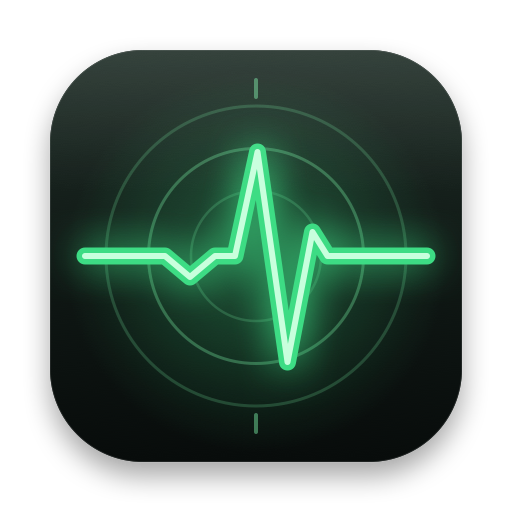
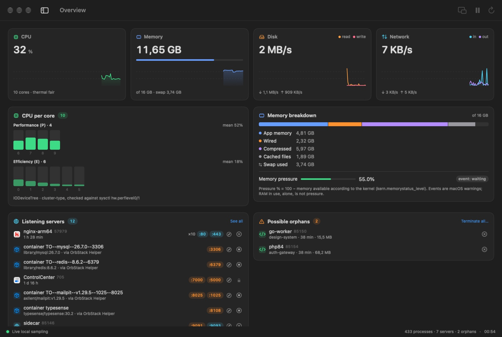
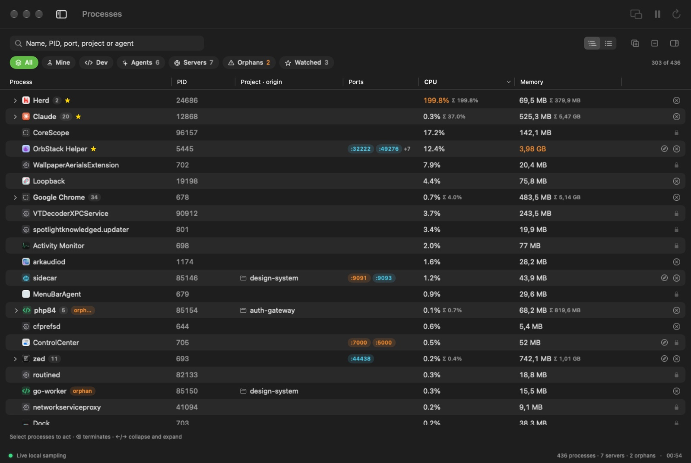
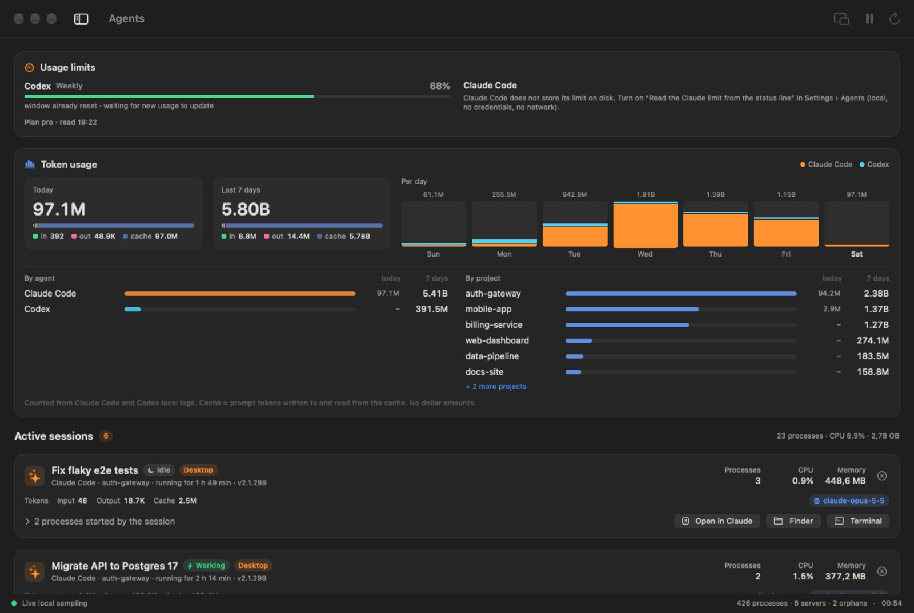
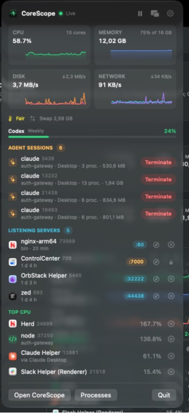
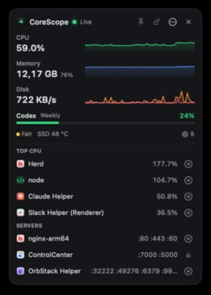

<p align="center">
  
</p>

<h1 align="center">CoreScope</h1>

<p align="center">
  <b>A system monitor for developers on macOS.</b><br>
  See which AI agent session, dev server or forgotten process is eating your Mac — and stop it in one click.
</p>

<p align="center">
  
  
  
  
  
</p>

<!--
  Demo GIF slot. Record docs/screenshots/demo.gif as described in CONTRIBUTING.md
  ("Recording the demo GIF"), then uncomment this block:
<p align="center">
  
</p>
-->
<p align="center">
  
</p>

---

## Why CoreScope?

Activity Monitor tells you *that* `node` is using 2 GB. It doesn't tell you **which project it belongs to, which agent or terminal started it, which port it's serving, or that its parent died an hour ago**.

If you work with Claude Code, Codex, editors and terminals all day, your Mac fills up with dev servers, MCP servers, language servers, watchers and the leftovers of sessions you already closed. CoreScope organizes all of that around the way you actually work — **projects, agents and ports** — and lets you clean it up without hunting for PIDs.

### Who it's for

- Developers running **AI coding agents** (Claude Code — desktop and CLI — Codex, Gemini CLI, Aider, OpenCode, Cursor Agent…) who want to see what each session spawned.
- Anyone juggling **local dev servers, containers and databases** (Node, Bun, Python, PHP/Herd, Go, Docker/OrbStack, Postgres, Redis…).
- People on **memory-constrained Macs** (8–16 GB) who need to know what to stop *right now*.

## Features

### 🌳 Process tree, built for dev work



- **Tree view by default.** Every app or tool heads its own tree; children of `launchd` become roots. Collapsed parents show the child count and **Σ totals** of CPU and memory for the whole subtree.
- **Project & origin columns.** The working directory (`cwd`) of each process and the agent, editor or terminal that started it ("via Claude Code", "via Zed", "via Warp").
- **Listening ports** per process, highlighted when exposed beyond loopback, with a one-click *open `localhost:port`*.
- **Filters:** All · Mine · Dev · Agents · Servers · Orphans · Watched — plus search by name, PID, port, project or agent.
- **Kill without opening windows:** ✕ on any row (click to arm, click to confirm), ⌫ / ⌘⌫ on the selection, *terminate tree* to stop a process and everything it started, and *force quit* (SIGKILL) when SIGTERM is ignored.
- **Live inspector** with origin, directory (open in Finder / Terminal), executable, resources and optional history.

### ✨ Agents



- Every **Claude Code** session (desktop app and CLI) and **Codex** session, with its title, *working / idle* status, project, how long it has been running, how many processes it started, ports, CPU and memory.
- **Terminate a whole session** — the agent and every server, shell and tool it spawned — in one action.
- **Codex weekly limit**, read from the `rate_limits` events Codex itself writes to `~/.codex/sessions` — no network, no credentials. Optionally shown in the menu bar and floating panel.
- **Claude Code 5-hour and weekly limits** (opt-in, Pro/Max plans), taken from the [`rate_limits` data Claude Code hands to its status line](https://code.claude.com/docs/en/statusline). Turn on *Settings → Agents → Read the Claude limit from the status line*; see [Privacy](#privacy) for exactly what it changes.
- **Possible orphans:** dev runtimes still running after their terminal, editor or agent went away.

### 🐳 Containers

- **Docker and OrbStack containers** (also Docker Desktop and Colima) with status, health, image, compose project, published ports, CPU and memory — on an Overview card and in full on the Agents page.
- **Listening servers name the container**: ports that OrbStack Helper or `com.docker.backend` hold for a container show up as *container &lt;name&gt;* instead of the VM helper.
- **Stop / Restart** in place with the same click-to-arm, click-to-confirm button used for processes.
- Read from the engine's **local Unix socket** only (`~/.orbstack/run/docker.sock`, `~/.docker/run/docker.sock`, Colima, `/var/run/docker.sock` or a `unix://` `DOCKER_HOST`), at most every 5 s and only while a container view is on screen.

### 📊 Menu bar and floating panel

<table>
<tr>
<td align="center" valign="top" width="50%">
<br>
<sub><b>Menu bar</b> — CPU, memory, disk and network charts, agent sessions, servers and top CPU, each with a stop button.</sub>
</td>
<td align="center" valign="top" width="50%">
<br>
<sub><b>Floating panel</b> — compact, standard or detailed layouts. Pin above windows, lock position, size, opacity and contents right from the panel (⋯ or right-click). Drag it anywhere.</sub>
</td>
</tr>
</table>

### And also

- **Storage & I/O:** per-device read/write, volume capacity (without double-counting APFS containers), NVMe temperature via public SMART APIs.
- **Honest metrics:** every value carries its source and timestamp; missing data is labeled, never faked. Memory is *active + wired + compressed*, and is never presented as "pressure".
- **Languages:** English, Portuguese and Spanish — follows your system language or a choice in Settings.
- **Dock behavior:** always, only while the window is open (default — close it and CoreScope lives in the menu bar), or never.
- **Shortcuts:** ⌘1…⌘6 pages · ⌘R refresh · ⇧⌘P floating panel · ⇧⌘Space pause / resume.

## Install

### Download (Apple Silicon)

1. Download `CoreScope-<version>-macos-arm64.dmg` from the [latest release](https://github.com/Tiagospem/corescope/releases/latest).
2. Open the DMG and drag **CoreScope** to **Applications**.
3. First launch: the app is open source and signed ad hoc, **not notarized by Apple**, so macOS blocks it the first time. Open it once, then go to **System Settings → Privacy & Security** and click **Open Anyway**. Alternatively, in Terminal:

   ```bash
   xattr -dr com.apple.quarantine /Applications/CoreScope.app
   ```

Each release lists SHA-256 checksums (`SHA256SUMS.txt`) so you can verify the download with `shasum -a 256 CoreScope-*.dmg`.

### Build from source

**Requirements:** macOS 14 or later · Xcode Command Line Tools (Swift 6) · Rust/Cargo. Developed and validated on Apple Silicon (MacBook Air M4, macOS 27); Intel Macs are untested.

```bash
xcode-select --install                                           # Swift toolchain, if needed
curl --proto '=https' --tlsv1.2 -sSf https://sh.rustup.rs | sh   # Rust, if needed
git clone https://github.com/Tiagospem/corescope.git
cd corescope
./scripts/build.sh
open build/CoreScope.app
```

The build produces `build/CoreScope.app`, signed **ad hoc** for your machine. To keep it, drag it to `/Applications`. The app asks for no special permissions: no root, no Full Disk Access, no helper tools, and *launch at login* stays off until you turn it on in Settings.

## Privacy

CoreScope is **local-only**: no network access, no telemetry, no accounts.

- Process names, executables, users, start times, working directories and listening ports are read locally through public macOS APIs (`libproc`, `sysctl`, IOKit). Working directories and ports are read only for **your own** processes.
- **Arguments and environment variables are never collected.**
- Agent data comes from local files only: the newest `rate_limits` event in `~/.codex/sessions` and the session metadata in `~/.claude/sessions`.
- **Claude Code limits are opt-in and off by default.** Claude Code does not store its usage limit on disk, and CoreScope never reads the Keychain, credentials or the network to fetch it. When you turn on *Read the Claude limit from the status line*:
  - CoreScope backs up `~/.claude/settings.json` (to `~/Library/Application Support/CoreScope/backups/`) and adds a `statusLine` command — only if you have none. An existing status line is never replaced; you can explicitly chain it (CoreScope's command runs first with `--record` and passes the input through, so your status line prints exactly as before) or edit it by hand. Every other key is preserved as written.
  - After each reply, Claude Code itself pipes the status line JSON to that command (`~/Library/Application Support/CoreScope/claude-statusline.sh`, a readable shell script). It keeps **only** `rate_limits` (percentages and reset times) in `claude-limits.json` next to it; nothing else from the session is stored.
  - The numbers refresh only when Claude Code replies, and only Pro/Max plans report them.
  - Turning the option off restores the previous `statusLine` exactly (or leaves it alone if you edited it since) and deletes the saved limits and the script (the script stays only while a hand-edited status line still calls it).
- Containers come from the Docker Engine API over its local Unix socket — never TCP, never registry or Docker Hub credentials. Nothing is read while no container view is on screen.
- History (up to 10 minutes) lives in memory only. Preferences and watched processes stay in `UserDefaults`.
- Nothing is ever killed automatically. Termination only targets your own, eligible processes, revalidates each process identity (PID + start time + executable) right before signaling, and never touches system services or CoreScope's own ancestors.

## Resource usage

A monitor shouldn't be what slows your Mac down. Measured on a MacBook Air M4 with ~450 processes:

| State | Memory (footprint) | CPU |
|---|---|---|
| Window open, sampling every 3 s | ~80 MB | ~2–3 % of one core |
| Window closed (menu bar only, sampling every 10 s) | ~85 MB | < 1 % of one core |

Sampling pauses during sleep and slows down in Low Power Mode.

## How it works

| Directory | Role |
|---|---|
| `core/src/macos.c` | Thin C adapter over public SDK APIs (libproc, Mach, sysctl, IOKit, NVMe SMART) |
| `core/src/containers.rs` | Docker Engine API client over local Unix sockets: container list, one-shot stats, stop/restart |
| `core/src/lib.rs` | Rust core: sampling, deltas, history, diagnostics, process classification (agents, editors, terminals, runtimes), origin and orphan detection, safe signaling, C ABI |
| `native/` | SwiftUI + AppKit app: window, menu bar extra, floating `NSPanel`, agents, localization |
| `scripts/` | Build, tests, procedural app icon, external read-only resource meter |
| `docs/` | Architecture, API sources, validation and measurement notes (English; Portuguese originals in `*.pt-BR.md`) |

The Swift UI calls the Rust core over a small C ABI that returns one JSON snapshot per sample on a serial background queue. See [`docs/ARCHITECTURE.md`](docs/ARCHITECTURE.md).

## Development

```bash
./scripts/test.sh     # cargo fmt --check, cargo test, clippy -D warnings, native logic tests
./scripts/build.sh    # release build into build/CoreScope.app
./scripts/package.sh  # DMG + zip + SHA-256 checksums into dist/ (release artifacts)
open --env CORESCOPE_DEMO=1 build/CoreScope.app   # demo mode: live metrics, anonymized user, home and session titles (quit with ⌘Q first)
```

The screenshots in this README were taken in demo mode. Demo mode doesn't rename folders under your home, so check captures before sharing them (see [CONTRIBUTING.md](CONTRIBUTING.md)).

## Roadmap

- Claude Code usage limits through Claude Code's documented status line data (opt-in, local only).
- Notarized releases and a universal (Intel) build.
- Validation on Intel Macs and macOS 14.

## Security

Please report vulnerabilities privately — see [SECURITY.md](SECURITY.md).

## Contributing

Issues and pull requests are welcome — see [CONTRIBUTING.md](CONTRIBUTING.md) for build and test commands, code style and the project principles (local-only, public APIs only).

## License

[MIT](LICENSE) © 2026 Tiago Padilha
