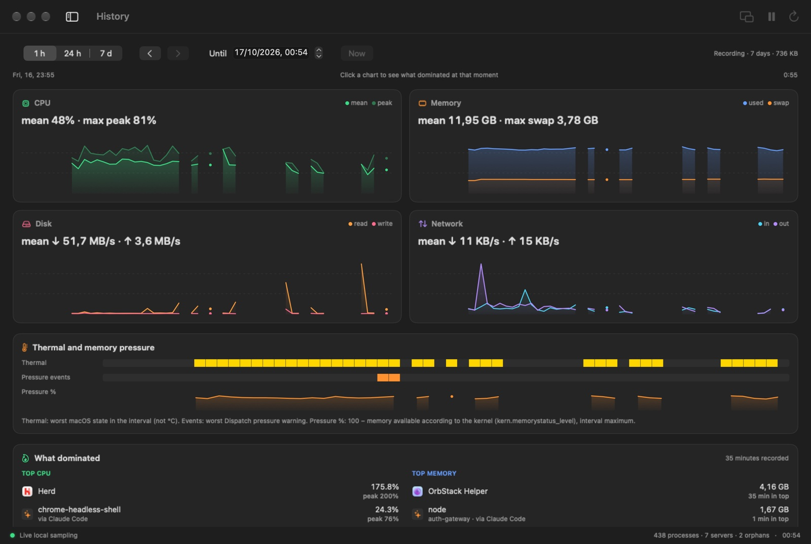
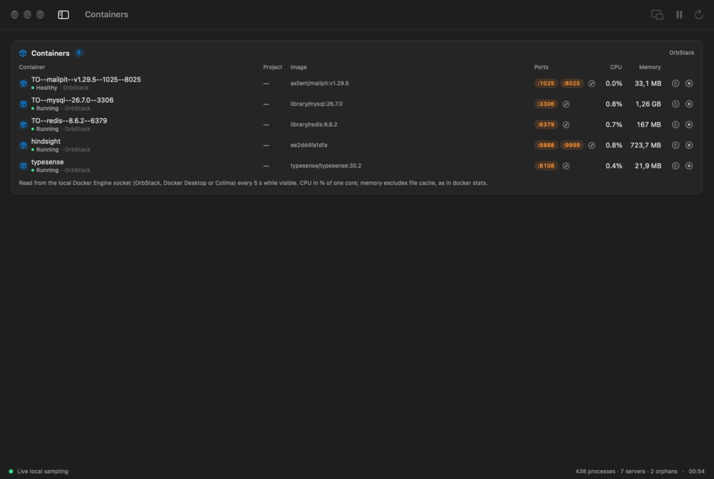

<p align="center">
  
</p>

<h1 align="center">CoreScope</h1>

<p align="center">
  <b>A system monitor for developers on macOS.</b><br>
  See which AI agent session, dev server or forgotten process is eating your Mac — and stop it in one click.
</p>

<p align="center">
  
  
  
  
  
</p>

<p align="center">
  
</p>

<p align="center">
  
</p>

---

## Why CoreScope?

Activity Monitor tells you *that* `node` is using 2 GB. It doesn't tell you **which project it belongs to, which agent or terminal started it, which port it's serving, or that its parent died an hour ago**.

If you work with Claude Code, Codex, editors and terminals all day, your Mac fills up with dev servers, MCP servers, language servers, watchers and the leftovers of sessions you already closed. CoreScope organizes all of that around the way you actually work — **projects, agents and ports** — and lets you clean it up without hunting for PIDs.

### Who it's for

- Developers running **AI coding agents** (Claude Code — desktop and CLI — Codex, Gemini CLI, Aider, OpenCode, Cursor Agent…) who want to see what each session spawned.
- Anyone juggling **local dev servers, containers and databases** (Node, Bun, Python, PHP/Herd, Go, Docker/OrbStack, Postgres, Redis…).
- People on **memory-constrained Macs** (8–16 GB) who need to know what to stop *right now*.

## Features

### 🌳 Process tree, built for dev work


- **Tree view by default.** Every app or tool heads its own tree; children of `launchd` become roots. Collapsed parents show the child count and **Σ totals** of CPU and memory for the whole subtree.
- **Project & origin columns.** The working directory (`cwd`) of each process and the agent, editor or terminal that started it ("via Claude Code", "via Zed", "via Warp").
- **Listening ports** per process, highlighted when exposed beyond loopback, with a one-click *open `localhost:port`*.
- **Filters:** All · Mine · Dev · Agents · Servers · Orphans · Watched — plus search by name, PID, port, project or agent.
- **Kill without opening windows:** ✕ on any row (click to arm, click to confirm), ⌫ / ⌘⌫ on the selection, *terminate tree* to stop a process and everything it started, and *force quit* (SIGKILL) when SIGTERM is ignored.
- **Live inspector** with origin, directory (open in Finder / Terminal), executable, resources and optional history.

### ✨ Agents


- Every **Claude Code** session (desktop app and CLI) and **Codex** session, with its title, *working / idle* status, project, how long it has been running, how many processes it started, ports, CPU and memory.
- **Terminate a whole session** — the agent and every server, shell and tool it spawned — in one action.
- **Codex limits**, by default from the last `rate_limits` event in Codex's local session logs. Recent Codex versions (the desktop app inside ChatGPT.app) no longer write those events, so turn on *Settings → Agents → Read the current limit through Codex* (or the button on the limits card) to ask Codex's own app-server — the same `account/rateLimits/read` call the Codex app makes — every 5 minutes: current usage, reset time, plan, credit balance and free resets. Optionally shown in the menu bar and floating panel.
- **Claude Code 5-hour and weekly limits** (opt-in, Pro/Max plans), taken from the [`rate_limits` data Claude Code hands to its status line](https://code.claude.com/docs/en/statusline). Turn on *Settings → Agents → Read the Claude limit from the status line*; see [Privacy](#privacy) for exactly what it changes. Without it, the percentages come from **Claude Desktop's own samples** (`~/Library/Application Support/Claude/plan-usage-history.json`): no reset time, marked with their age. Both only refresh while they are used — the status line on terminal replies, Claude Desktop now and then, sometimes hours apart — so for numbers you can actually monitor turn on *Settings → Agents → Read the current limit through Claude Code* (or the button on the limits card): CoreScope runs Claude Code's own `/usage` (`claude -p /usage`, no model turn, no tokens) every 5 minutes while a Claude session is working and every 30 minutes otherwise, and shows the same 5-hour and weekly numbers, with reset times, that Claude Code and Claude Desktop show. The panel, menu bar and overview always show the newest of the three sources.
- **Pace**: for every window with a reset time, where it is heading at the average pace so far — "~70% at the reset", or "hits 100% at 16:40" in orange. MCP `usage_limits` returns Claude and Codex with source, age, reset and pace.
- **Token usage**, counted from the agents' own local transcripts: input, output and prompt-cache tokens plus the model on each session card, and totals for today and the last 7 days per agent and per project. Tokens only — no dollar estimates.
- **Possible orphans:** dev runtimes still running after their terminal, editor or agent went away.

### ⏳ Stuck agents

A busy Claude Code session or Codex thread that has not written to its transcript for a while (10 min by default) gets a badge on the Agents page, and optionally a notification that opens it in Claude or Codex. CoreScope tells the cases apart by what the commands started in the current turn are doing: one using CPU is a **long command** (a build, a test run); one sitting idle is **waiting** — often a prompt asking for input; nothing running at all means the agent itself looks **stuck**. Servers it left listening and processes from earlier turns (MCP servers) are ignored. Only modification times are read, never transcript content.

### 📄 Profiles as code

Commit a `.corescope.yml` and the whole team gets the same environment. CoreScope finds it in the folders you and your agents work in, shows its profiles (read-only, marked with the file) and its Services checks, and agents can read or write it over MCP (`read_project_config`, `write_project_config`); `corescope config` validates it.

```yaml
name: Revamp

profiles:
  dev:
    commands:
      - name: web
        run: php artisan serve --port 8000
      - run: npm run dev
    containers: [TO--mysql--26.7.0--3306, TO--redis--8.6.2--6379]
  qa:
    commands:
      - name: env
        run: make test-env-up
        stop: make test-env-down

ports:
  web: 8000

services:
  - name: API
    target: http://localhost:8000/up

logs: [storage/logs/*.log]

agents:
  wait_for_capacity:
    cpu_below: 70
    memory: normal
    max_wait_minutes: 30
    heavy_commands: [php artisan test, npm run build]
```

The format is plain YAML (maps, lists, quoted or plain values, comments); anything fancier is rejected with the line number.

Projects whose environment is run by their own controller (a `bin/eco` that knows the Compose files, which apps are on and dev/build modes) can say so under `environment:`: each app with the modes it comes up in (one at a time), the command that takes it down and its actions (setup, backups, confirmed restores), a `status` command that reports the real state, and `services[].app` / `component` to tie a check to what needs it. CoreScope runs the commands and watches; it never starts or stops those containers itself. See [Environment controllers](docs/ENVIRONMENT-CONTROLLER.md).

### 📜 Logs

Every log of every project in one place, for any stack: log files found in the usual folders (`storage/logs`, `log`, `logs`, `var/log`, `*.log` at the root) plus the `logs:` globs in `.corescope.yml`, the output of profile commands, and container logs. Tail one live, search a project, or see its recent errors — detected by the level each line declares, or by generic markers (`Exception`, `Traceback`, `panic`, `FATAL`…) — with their stack traces and repeats folded into a count. Agents get the same over MCP (`recent_errors` for a profile or project, `tail_log`, `search_logs`, `list_log_sources`), so they can debug without you pasting logs; and `corescope logs --errors` works in a terminal.

### ⏸️ Agents wait for capacity

When an agent starts a full test suite on a Mac that is already at 90% CPU, everything slows down and a ten-minute task takes hours. A project can opt in, in `.corescope.yml`:

```yaml
agents:
  wait_for_capacity:
    cpu_below: 70          # % of all cores
    memory: normal         # or warning
    max_wait_minutes: 30   # then run anyway
    heavy_commands: [php artisan test, npm run build]   # empty = common builds and test suites
```

- **Claude Code and Codex** — *Settings › MCP server for agents › Agent hooks › Wait for room before heavy commands* installs a `PreToolUse` hook (`corescope gate`) in `~/.claude/settings.json` and/or `~/.codex/hooks.json`, each backed up first. Before a heavy command in such a project it waits until CPU and memory pressure are back under the limit (two good readings in a row), then lets it run. Other commands and other projects pass in a few milliseconds. It delays, it never blocks. Codex runs a user hook only after you trust it in its `/hooks` screen; the settings show whether it does.
- **Other agents** — the MCP server tells them to call `wait_for_capacity` (and `system_capacity`) before heavy commands in those projects.
- **You see it** — the Agents page lists who is waiting, for which command and why. `corescope wait` does the same for your own scripts.
- **Agents learn the project's rules on their own** — *Project context at session start*, the other agent hook, runs `corescope context --hook` when a Claude Code or Codex session starts: the nearest `.corescope.yml` is summed up as context for the agent (the capacity rule and its heavy commands, preferred ports, profiles to start instead of running commands by hand, services, logs to read instead of asking you, a snapshot before wiping a database — or the file's error with its line). Nothing is said in folders without one. Agents without hooks get the same text from MCP `agent_context`, or from a marked section CoreScope writes into the project's `CLAUDE.md` / `AGENTS.md` (*Agent instructions…* on the project's card, `corescope context --write all`, MCP `write_agent_instructions`); the rest of those files is never touched, and `--remove` takes the section out. MCP `agent_hooks` reports and changes the hooks.
- **Economy mode** (Energy page): on battery, busy processes agent sessions start run at macOS background priority, so they yield CPU and disk to what you are doing; servers with open ports are left alone, and everything returns to normal on AC.

### 🔌 Ports

- **Reachable from the network**: everything of yours listening beyond `localhost` — processes and container ports published on `0.0.0.0` — ranked by risk: databases, caches and queues high (they often run without a password in development), dev servers medium, macOS services low; each with how to bind it to `127.0.0.1` (for compose, `"127.0.0.1:3306:3306"`).
- **Projects' preferred ports**: the `ports:` of each `.corescope.yml` — free, in use by the project itself, or taken by something else (who holds it, and the next free port).
- **Free port finder** and every listening server with its project, open-in-browser and terminate.
- `corescope exposure`, `corescope ports --check`, and MCP `exposure_report` / `port_conflicts` (check before starting a server on a fixed port).

### 💚 Services

Watch the things your work depends on: a local API's `/health`, a database port, a staging URL. Each check runs every 30 s while CoreScope is open — an HTTP GET (2xx/3xx up, 4xx answered with an error, 5xx or no answer down) or a TCP connect — with latency, a strip of the last 40 results, an Overview summary and optional notifications when a service goes down (two failures in a row) or comes back. Ports you have open right now are offered as one-click suggestions.

Each check keeps a week of history in 5-minute buckets (counts and latency only): uptime over 24 h and 7 days next to it, and a sheet with incidents and the day's latency. MCP `list_services` includes uptime and recent incidents.

Checks are grouped by project (checks you added in the app have their own group), each with a summary such as *1 down · 4 up*. A check from a project's `.corescope.yml` whose profile is not running and whose port nobody listens on is shown in gray as **not running** — the app is just switched off — with a *Start* button for the project's profile. These are the app's health checks, so while the app is off they aren't probed at all (checking resumes when the profile starts or the port opens), don't count against uptime and send no notifications. Red is kept for what should be up: the profile is running, something listens on the port but fails, or the check was added by hand. The row's tooltip says which. A check or a whole group can be paused (not probed, no history, no alerts). MCP `list_services` / `check_services` report the same `status` (`up`, `answered_with_error`, `down`, `not_running`, `paused`) with the `group` and an `explanation`; `pause_service` pauses or resumes a check or a project.
### ▶️ Profiles

One click to bring a project's environment up or down. A profile is a folder, the commands you run there every day (`npm run dev`, `php artisan serve`, `cargo watch -x run`…) and the containers it needs. *Start* runs each command in your login shell inside the folder, in a session of its own, with output in `~/Library/Application Support/CoreScope/logs`, and starts the containers. Everything a command starts keeps that session, so servers it leaves running in the background still belong to the profile — after the shell exits and after CoreScope restarts — with their PIDs and ports on the card. Setup commands that exit (`make env-up`, `docker compose up -d`) count as done when they exit 0 (failed otherwise), and can have an *on stop* command (`make env-down`) that Stop runs. *Stop* (after confirmation) sends SIGTERM only to the processes in the sessions CoreScope started for that profile — identity-checked like every other termination — and stops its containers — only the ones a profile started, and never one another started profile still uses: shared containers (one database for several projects) stay up until the last profile using them stops, and the confirmation lists what stops and what stays. *Stop everything* is there when you want it all down.

### 📁 Projects

Register the local repositories you work on and follow them without an IDE. *Add project…* picks a folder; the name comes from `name:` in its `.corescope.yml` (or the folder's name) and stays editable. The `.corescope.yml` is validated with the same parser as the rest of the app — errors show their line — and the card sums up what it enables (profiles, ports, Services, logs, agent capacity). A folder without one gets a minimal file (just the name) from the existing writer; decline and the project is not added. Git is detected through the `git` command line (so your config and hooks apply): repository root, linked worktree and its main repository, a subfolder of a monorepo, branch or detached HEAD; a folder without a repository can run `git init` after a confirmation. Removing a project only takes it off the list. `corescope projects` and MCP `list_projects`.

**Changes and commit.** Each repository's card already says what changed — staged, modified, new, deleted and conflict counts, ahead/behind, and the total next to *Changes* — refreshed live while the page is open (the same watcher rules below). *Changes* opens a commit panel in the style of Zed or PhpStorm: the branch with its upstream and ahead/behind, the last commit, and the changed files grouped into Conflicts, Staged, Modified, New and Removed — each with its path, status letter and +/− lines (a partially staged file shows in both halves). The checkbox stages or unstages; ⌘/⇧-click selects several, and *Stage all* / *Unstage all* work on everything. The diff on the right reads like Zed's: with nothing selected, every change since the last commit stacked file by file (or just the selected files, staged or working-tree side), each under a pinned header with its stage checkbox, name, folder, +/− and *Open*; a gutter bar marks added (green), removed (red) and modified (yellow) lines, removed lines carry no number, new-side line numbers, syntax colors for the usual languages, unchanged stretches folded into "⋯ N unchanged lines" (click to show the whole file), and ↑/↓ to jump between changes. The context menu opens the file in an installed editor (Zed, Cursor, VS Code, JetBrains IDEs, Xcode… the choice is remembered) or reveals it in Finder. *Discard changes…* always asks: tracked files go back to the last commit, new files go to the Trash. The commit box is disabled without a message, with nothing staged or with conflicts left; ⌘↩ commits, your hooks and signing run, and a failing hook's output is shown as is. An `index.lock` held by another git becomes a banner, never a crash. While the panel is open, FSEvents (0.5 s latency) refreshes it: inside `.git` only HEAD, the index and refs count, and paths that `.gitignore` covers are dropped after one `git check-ignore` per folder — the watcher stops when you leave, and its cost shows under *CoreScope's own cost* as *Projects (git)*. `corescope status [PROJECT|FOLDER]`, `corescope://project/NAME`, MCP `project_git_status` / `project_git_diff` / `project_git_stage` / `project_git_commit` / `project_git_discard`. 

**Branches and worktrees.** Two collapsible sections on each repository's card, closed by default (git runs only when one is opened). *Local branches*: the current one first, then newest, with the last commit, upstream ahead/behind, *up to date*, *upstream gone* or *no upstream*, and a badge when the branch is checked out in another worktree; the first 12 show, *Show all* for the rest. *Worktrees*: every working tree of the repository, main first — branch, the agent that made it, merged into the default branch, uncommitted changes, a process working in it, `git worktree lock`, folder gone, last commit, and its size, measured in the background one at a time and cached for 10 minutes (worktrees nested in another one are not counted twice). Rows are grouped into *In use* (the checkout, the main tree, a process inside, a branch checked out), *Removable* and *Other*, with the removable count and size next to the title. `corescope branches [PROJECT|FOLDER]`, `corescope worktrees PROJECT`, MCP `project_branches` / `project_worktrees`.

**Remove unused worktrees and branches.** *Remove unused…* lists, before anything happens, the linked worktrees whose branch is merged into the default branch (or whose upstream or folder is gone) and the local branches merged into it, each with its path, size and reason, and a checkbox. The main and current working tree, a worktree any process works in, a locked one and a branch checked out in a worktree that stays are never offered; one with uncommitted changes is skipped unless you tick the separate *allow uncommitted changes* option (`--force`). Removal is `git worktree remove` then `git branch -d` (never `-D`), each item checked again first, with a result per item. Ignored files inside a worktree (`node_modules`, builds, `.env`) go with it. MCP `project_unused` (dry run) and `project_remove_unused` (same rules, never forced). 

**In the floating panel and the menu bar.** *Show in panel* (the project card's menu, the panel's *…* › *Projects in the panel*, or MCP `set_project`) puts a project in the floating panel — a row with name, branch and counts in the standard and detailed layouts, a cell in the compact strip — and in the menu bar popover. Their counts are read when the panel or popover appears and kept live by the same file watchers while it is on screen; nothing runs otherwise. Clicking one opens its changes (the panel above) in a window of its own, without the main window. 

**Change notifications** (opt-in, off by default). *Notify changes* — every 1, 5 or 15 minutes — on the project card's menu, in *Settings › Notifications*, or MCP `set_project`. A file watcher only marks the project as touched; at its interval a touched project is read once and compared with what was last notified, so a notification says what moved — *+3 new, +2 modified · new commit on main · 9 changes now*, or a branch switch — and saving an already modified file never notifies. At most one per project per interval; clicking opens its changes. 

**AI commit message** (opt-in, off by default — see [Privacy](#privacy)). With *Settings › AI* on, the changes panel gets *Generate message*: it writes the message from the staged diff only (lockfiles and binaries left out, cut at a configurable size) with your provider — Claude Code or Codex already installed (their own login, no key), the Anthropic, OpenAI or Gemini API (key in the Keychain), or Ollama / LM Studio locally — following editable instructions (Conventional Commits by default, title up to 72 characters) in the language you pick. The model is a free-text field with suggestions of fast, inexpensive ones; *Test connection* checks provider, model and key. The message fills the field for you to edit; nothing commits on its own. MCP `generate_commit_message`.

### 👥 Agents side by side

The Agents page flags **sessions sharing one working tree** (Claude Code sessions and running Codex threads in the same folder): they can overwrite each other's files and fight over ports and dev servers, so each should get its own git worktree. `corescope agents` and MCP `list_agent_sessions` report the same, and `corescope worktrees` / MCP `list_worktrees` list the worktrees agents left, with branch, merged state, uncommitted changes and whether something is using them.

### 🗄️ Databases

The MySQL/MariaDB, PostgreSQL and Redis servers running on this Mac — as processes or containers — with version, uptime, size per database (keys per db for Redis), connections, slow-query counters and the queries running for more than 5 seconds. CoreScope speaks each database's own protocol on 127.0.0.1 with read-only queries, each capped on the server too. **It never asks for, stores or reads passwords**: it connects only where the server allows passwordless local access (MySQL `root` without a password, PostgreSQL trust for your user, Redis without AUTH) and otherwise just shows that a password is required. Also `corescope db` and the MCP tool `list_databases`.

- **Open in** TablePlus, Redis Insight, Sequel Ace, Postico or DBeaver (whichever is installed) with the connection filled in, or **copy the DSN** — never with a password.
- **Redis by prefix**: *Scan* on a Redis database samples its keys (`SCAN`, then `MEMORY USAGE` and `TTL` in one pipelined batch), groups them by prefix — going one level deeper when one namespace holds everything (`go:task:`, `go:batch:`) — and shows estimated keys and memory per prefix and how many **never expire** (a common slow leak). *Empty db…* runs `FLUSHDB` after a confirmation, for development data. `corescope db redis PORT --db N`, MCP `redis_keyspace` / `redis_flush`.
- **Snapshots** before risky work: *New snapshot…* dumps one MySQL/MariaDB or PostgreSQL database to a gzipped SQL file under `~/Library/Application Support/CoreScope/db-snapshots`, and *Restore* puts that database back exactly (it is dropped and recreated from the dump). For a **container**, the dump runs inside it (`docker exec`) with the container's own credentials from its environment (`MYSQL_ROOT_PASSWORD`, `MARIADB_*`, `POSTGRES_USER`) passed through `MYSQL_PWD`, so CoreScope never reads or stores a password and none appears in a process's arguments; the database name is validated and passed as an argument, never interpolated. Host databases need passwordless local access, like the rest of the page. Agents get `db_snapshot`, `db_snapshots` and `db_restore` over MCP, and the MCP instructions ask them to snapshot before `migrate:fresh`, `db:wipe` or a migration reset. `corescope db snapshot PORT DATABASE`, `corescope db snapshots`, `corescope db restore ID`.

### 🖥️ Machines

Servers you reach over ssh — add an alias from `~/.ssh/config` (offered as suggestions) or `user@host` — refreshed every 60 s while the page is open: distribution, uptime, load against cores, memory and swap, every disk, top processes by CPU and by memory, failed systemd units and the containers with their state. CoreScope runs **your own `ssh` in BatchMode** with a fixed, read-only script piped to `sh -s`: keys and agent stay with ssh, nothing prompts for a password, and a host whose key is unknown fails instead of being accepted. Only `Host` names are read from your ssh config.

- **Alerts** on the card (and optional notifications): a disk above 90%, load sustained above 1.5× the cores, failed systemd units, a container that stopped or fails its health check.
- **Why a unit failed**: click a unit in the *Failed systemd units* alert and CoreScope runs `systemctl status <unit>` and `journalctl -u <unit>` over the same BatchMode ssh (read-only, no sudo; the unit name is validated first). The last run's `error`/`failed` lines are grouped with counts (`unknown user 'x'` × 27), with a one-line hint for well-known causes: a logrotate config left for a deleted site user (e.g. Laravel Forge's `/etc/logrotate.d/forge-*`), two configs rotating the same log (`duplicate log entry`), a failed postrotate script, an `nginx -t` error. Hints only explain; CoreScope never changes the server. When journald hides system logs from your ssh user (not in `adm`/`systemd-journal`), it says so instead of showing nothing. Agents get the same with MCP `explain_failed_unit`.
- **Recipes**: commands that run on demand — built-in read-only ones (journal, failed units, `df`, memory, containers, top, listening ports, nginx errors) and your own. Agents run them by name over MCP (`list_recipes`, `run_recipe`), never free-form commands.

### 🔋 Energy

Battery level, charging state and time left, the watts each process draws right now (macOS's own per-process CPU/GPU energy, `rusage` v6 `ri_energy_nj`), and each agent session's power including everything it started. Optional alert when, on battery, an agent session stays above a limit (3 W by default) for 5 minutes. Also `corescope power`, `corescope top --energy` and the MCP tool `power_usage`.

### 🕒 History (opt-in)



- Answers *“what made my Mac slow yesterday at 3 pm?”*: 1 h, 24 h and 7 d views of CPU (mean and peak), memory and swap, disk, network, thermal state and memory pressure, with gaps where nothing was recorded.
- Click any chart to see **the processes that dominated that moment** (top CPU, memory and power, with project and “via Claude Code”-style origin); step back period by period or jump to a date.
- **What happened at 2:05 pm?** Pick a moment (or type `14:05` in ⌥⌘K, open `corescope://happened?at=14:05`, run `corescope happened 14:05`, or let an agent call `what_happened`): CPU and process power in the 10 minutes around it against the hour before, memory, swap growth, pressure, thermal state, disk writes and who dominated.
- Since 0.5 History also records total process power and the 10 processes drawing the most each minute (older files are upgraded in place; earlier minutes keep no power).

### 💾 Storage

- **Using the disk now**: the processes reading and writing the most, from per-process counters (`corescope top --disk`, MCP `top_processes by: disk`).
- **SSD health** under each disk, from the NVMe SMART log page the system already reads for temperature: percentage of rated endurance used, available spare, terabytes written and read, average written per hour powered on, power cycles, unsafe shutdowns, media errors and a verdict (healthy, watch, replace) with reasons. Disks behind adapters that hide SMART say so. `corescope disk-health`, MCP `disk_health`.
- **Free up space safely**: caches and stores tools re-create on demand — Xcode DerivedData, unavailable simulators, npm/Yarn/pnpm/Cargo/Go/Gradle/Composer/pip caches, Homebrew cleanup, Docker build cache and untagged images — each with the space it frees, the exact command or folders it touches, and a check that its tool is not running. Folders go to the Trash; commands run with the tool's full path; Docker data is removed by the engine (marked permanent). `corescope space --plan`, MCP `cleanup_plan` / `run_cleanup_plan` (destructive, so agents ask).
- **Large files**: on demand, the largest files in your home folder and the folders it links to other drives — disk images, videos, VMs, dumps, models — with age, Quick Look, Finder and Trash. The walk stays on each folder's own filesystem (never into OrbStack's NFS or network shares) and skips cloud storage (OneDrive, iCloud), `node_modules` and `.git`; files an app manages (Docker, OrbStack, Claude, Photos, Hugging Face's cache) are shown but not offered for the Trash. `corescope large-files`, MCP `large_files`.
- **Eject…** on external volumes: the processes holding the volume — running from it, with files open on it, or working inside it — with a stop button each, then `diskutil eject`; if a system service still holds it, macOS's message says which. `corescope eject-check VOLUME`, MCP `volume_holders` / `eject_volume`.

### 💾 What grew today

The Storage page measures the folders that usually fill a developer's disk — caches, Xcode DerivedData and simulators, Docker/OrbStack/Colima VMs, npm/pnpm/Yarn/Bun/Cargo/Go/Gradle/Maven/Composer stores, `~/.cache`, model folders (Ollama, LM Studio, Hugging Face), Downloads, Trash and Claude/Codex data (symlinked ones too) — at most every 6 hours in the background and on demand, and shows what grew since the last measurement before today, with free space. Each folder opens to the subfolders that grew, and folders the cleanup plan can free (npm, Cargo, DerivedData…) get a *Free* button that checks that action. `corescope disk-growth [--measure]` and MCP `disk_growth` give the same.

### 🐳 Containers



- **Docker and OrbStack containers** (also Docker Desktop and Colima) with status, health, image, compose project, published ports, CPU and memory — on an Overview card and on their own **Containers** page.
- **Listening servers name the container**: ports that OrbStack Helper or `com.docker.backend` hold for a container show up as *container &lt;name&gt;* instead of the VM helper.
- **Stop / Restart** in place with the same click-to-arm, click-to-confirm button used for processes.
- Read from the engine's **local Unix socket** only (`~/.orbstack/run/docker.sock`, `~/.docker/run/docker.sock`, Colima, `/var/run/docker.sock` or a `unix://` `DOCKER_HOST`), at most every 5 s and only while a container view is on screen.
- **Grouped by compose project**, with *Start all* / *Stop all*, a start button for stopped containers, the restart policy (`unless-stopped`, `always`…) and how old each image is.
- **Volumes** with their size, when they were created, what made them (compose project, anonymous) and which containers use them. **Unused volumes can be removed**, one by one or with *Remove unused…*, after a confirmation that lists names and sizes: only volumes no container references (running or stopped), re-checked right before, removed by the engine without force — the data does not come back.
- **Agents too**: MCP `list_containers`, `container_logs`, `container_action` (start/stop/restart), `list_volumes` and `remove_volumes` (a dry run unless the agent passes `confirm: true` after asking you; volumes in use are always refused). Stopping a container a started profile uses is refused with the profile's name unless the agent passes `force` after asking you. `corescope containers` prints the same in a terminal.

### 🧹 Cleanup

Finds reclaimable developer space and shows what each item is, where it is, its size and when it last changed:

- **Projects:** `node_modules` (next to a `package.json`) and Rust `target/` (with Cargo's `CACHEDIR.TAG`), in the folders you add and in the folders holding the projects your agents, editors and terminals are working in.
- **Xcode:** DerivedData per project, device support files, Simulator caches.
- **Package caches:** Homebrew, npm, Yarn, pnpm, Bun, Cargo, pip, uv, Go, Gradle, Composer, CocoaPods.
- **Git worktrees** that agents leave behind (Claude Code's `.claude/worktrees`, Codex, Conductor, Cursor, or any `git worktree add`), with agent, branch and whether it is merged. One with uncommitted changes, a git lock or any process inside (a terminal included) is locked; a clean one goes to the Trash and `git worktree prune` drops git's record of it — the branch stays.
- **Docker:** dangling images, images no container uses, unused build cache (through the engine's own API).

Nothing is scanned until you press *Scan*: the last result is kept in `~/Library/Application Support/CoreScope/cleanup-cache.json` (paths, sizes and dates) and the page says when it may be out of date (older than 6 hours, or the folder list changed). Select items (or *Unused 30+ days*) and confirm: folders go to the **Trash**, so they can be recovered until you empty it. Anything a process is using — a dev server in the project, `cargo`, Xcode, an agent working there — is locked, and every folder is re-checked by the core right before it moves: still a real folder (no symlinks), still one of the kinds above, still unused. Docker data is removed by Docker and pulled again when needed.

### 📊 Menu bar and floating panel

<table>
<tr>
<td align="center" valign="top" width="50%">
<br>
<sub><b>Menu bar</b> — CPU, memory, disk and network charts, agent sessions, servers and top CPU, each with a stop button.</sub>
</td>
<td align="center" valign="top" width="50%">
<br>
<sub><b>Floating panel</b> — compact, standard or detailed layouts. Pin above windows, lock position, size, opacity and contents right from the panel (⋯ or right-click). Drag it anywhere.</sub>
</td>
</tr>
</table>

### 🔔 Notifications and port lookup

- **Opt-in notifications** (Settings → Notifications, all off by default, delivered locally through macOS UserNotifications):
  - a **new possible orphan** appeared, with its project and port — and a **Terminate** button that sends SIGTERM through the same path as the app (identity revalidated right before the signal);
  - a process **stays above** a memory size (default 2 GB) or CPU (default 150 % of one core) for a while (default 60 s);
  - macOS **memory pressure** reaches *warning* or *critical*, naming the biggest consumer.

  At most one notification per process identity (PID + start time) per hour. Protected processes and other users' processes never notify. Rules run on the snapshots CoreScope already collects — no extra timer or sampling.
- **Port lookup and quick actions in the menu bar:** type a port (e.g. `3000`) to see which of your processes listens on it — name, project, origin — with *open `localhost:port`* and ✕ (an empty result reads *Free*); type words to start or stop a profile, check a service, open a project folder or any page, pause sampling, or `14:05` for what happened then. Return runs the first match.
- **Profiles and Services in the menu bar:** start or stop up to five profiles and see every service check as a coloured dot, without opening the window.
- **Global shortcut ⌥⌘K** (configurable in Settings → Port shortcut) opens the menu bar popover with the port field focused. It is registered with Carbon's `RegisterEventHotKey`, so it needs **no Accessibility or Input Monitoring permission**: the app receives only that one key combination, never other keystrokes. (macOS 27 no longer exposes a public way to open a `MenuBarExtra` window, so there the shortcut shows the same menu in a standard popover anchored to the status item.)

### 🔗 `corescope://` links, Shortcuts and Raycast

CoreScope registers the `corescope://` URL scheme, so Shortcuts (*Open URLs*), Raycast quicklinks, Alfred, scripts (`open "corescope://…"`) and bookmarks can drive it:

| Link | Does |
| --- | --- |
| `corescope://open/ports` | Opens a page (`overview`, `processes`, `agents`, `containers`, `history`, `storage`, `cleanup`, `services`, `profiles`, `databases`, `machines`, `energy`, `logs`, `ports`, `sensors`, `settings`) |
| `corescope://profile/start?name=Revamp%20Test` | Starts a profile (`stop`, `toggle` too). A profile from a `.corescope.yml` asks first, showing its commands, so a web page cannot run a cloned project's commands |
| `corescope://lookup?port=8000` | Opens the port lookup with that port |
| `corescope://services/check` | Runs every service check now |
| `corescope://happened?at=14:05` | History's *What happened at…* for that moment |
| `corescope://palette` | Opens ⌥⌘K |
| `corescope://project/demo-shop` | A registered project's changes (by name or id) |

For scripts that need an answer rather than an action, use the command line below (`--json`).

### ⌨️ Command line

Install it from *Settings → Command line* (a link in `~/.local/bin`), or get it with the [Homebrew cask](#homebrew). Every command accepts `--json`, so agents can use it too:

```bash
corescope ports                    # listening ports with process, project and origin
corescope free-port 3000           # first free localhost port from 3000
corescope kill-port 3000           # stop what listens on :3000 (asks first; --yes, --force)
corescope agents                   # agent sessions, what they started, their ports
corescope orphans                  # dev runtimes left running without their parent
corescope top --mem -n 10          # top processes by memory (or CPU)
corescope kill 4242 --tree         # stop a process and everything it started
corescope space                    # reclaimable node_modules, target/, Xcode, caches, Docker
corescope db                       # local MySQL/PostgreSQL/Redis: sizes, connections, slow queries
corescope power                    # battery, watts per process and per agent session
corescope config                   # validate this project's .corescope.yml
corescope logs --errors            # this project's recent errors, with traces
corescope wait                     # wait until the Mac has room (the project's rule or flags)
corescope exposure                 # what listens beyond localhost, riskiest first
corescope happened "2:05 pm"       # what the Mac was doing then (needs History on)
corescope disk-growth --measure    # which usual folders grew today
corescope disk-health              # SSD wear, TB written, unsafe shutdowns (NVMe SMART)
corescope space --plan             # safe cleanup plan with estimates and exact commands
corescope large-files              # largest files in your home and linked drives
corescope eject-check "/Volumes/HD"  # what keeps a volume from ejecting
corescope status shop              # a project's (or this folder's) git changes: branch, staged, modified, new
corescope branches shop            # local branches: current, last commit, ahead/behind, worktree
corescope context                  # what this project's .corescope.yml asks of agents (--write all: CLAUDE.md, AGENTS.md)
corescope db snapshot 3306 shop    # snapshot a database before migrate:fresh (db restore ID)
corescope version --check          # this version, and whether a newer release exists (asks the app)
```

Termination follows the app's rules: only your own processes, never system services or the command's own ancestors (an agent cannot stop its own session), identity revalidated right before each signal, and no signal without `--yes` when there is no terminal to confirm in.

### 🤖 MCP server for agents (opt-in)

Off by default. *Settings → MCP server for agents → Enable* registers `corescope mcp` (a stdio MCP server inside the app) with **Claude Code** (`claude mcp add --scope user`) and/or **Codex** (`codex mcp add`); *Disable* removes it. Agents then get these tools:

| Tool | What it does |
| --- | --- |
| `list_ports` / `find_free_port` | Listening ports with process and project; first free localhost port |
| `top_processes` / `system_summary` | Heaviest processes by CPU or memory; CPU, memory, swap and disk at a glance |
| `list_agent_sessions` / `list_orphans` | Agent sessions and what they started; dev runtimes left without a parent |
| `list_my_processes` | What the calling agent session started, including servers it detached |
| `power_usage` | Battery, total watts, top processes and agent sessions by power |
| `list_databases` | Local MySQL/PostgreSQL/Redis status (read-only, no passwords) |
| `list_recipes` / `run_recipe` | Read-only commands on a machine, run by name over your ssh |
| `explain_failed_unit` | Why a failed systemd unit failed: status, the last run's errors grouped, a hint for known causes (read-only) |
| `exposure_report` / `port_conflicts` | What listens beyond localhost (risk and fix); projects' preferred ports and who holds them |
| `list_worktrees` | Git worktrees agents left: branch, merged, uncommitted changes, in use |
| `agent_context` / `write_agent_instructions` | What the project's `.corescope.yml` asks of agents, as instructions; the same as a marked section in `CLAUDE.md` / `AGENTS.md` |
| `agent_hooks` | CoreScope's session-context and capacity hooks in Claude Code and Codex: which are installed, Codex's trust in them, install or remove one |
| `system_capacity` / `wait_for_capacity` | Whether the Mac has room for heavy work under the project's rule; wait until it does |
| `list_containers` / `container_logs` / `container_action` | Containers with project, ports, restart policy and volumes; logs; start/stop/restart under the profiles' sharing rules |
| `list_volumes` / `remove_volumes` | Docker volumes with size, creator labels and the containers using them; remove unused ones (dry run unless `confirm: true`; never one in use) |
| `recent_errors` / `search_logs` / `tail_log` / `list_log_sources` | A profile's or project's logs: errors with traces and counts, search, tail |
| `read_project_config` / `write_project_config` | The project's `.corescope.yml`, parsed and validated / written as commented YAML |
| `what_happened` | What the Mac was doing around a moment (History): CPU and power against the hour before, swap, pressure, thermal, who dominated, in plain English |
| `disk_health` / `large_files` | SSD health from NVMe SMART; the largest files in the home folder (read-only) |
| `cleanup_plan` / `run_cleanup_plan` | Safe cleanup plan with estimates and exact commands; run chosen actions (destructive, asks) |
| `volume_holders` / `eject_volume` | What keeps a volume from ejecting; eject it |
| `db_snapshot` / `db_snapshots` / `db_restore` | Snapshot a MySQL/PostgreSQL database before risky work; restore it (asks) |
| `redis_keyspace` / `redis_flush` | Redis memory by key prefix and keys without TTL; FLUSHDB (asks) |
| `disk_growth` | Which usual folders grew today, and free space |
| `list_dev_space` | Reclaimable space (read-only; cleaning stays in the app, with your confirmation) |
| `stop_port` / `stop_process` | Stop a process (or a port's owner), **only if this agent session started it** |

With *Agents can use the app through MCP* (on by default once the server is registered), the server also reaches the running app over a private Unix socket (`~/Library/Application Support/CoreScope/control.sock`, mode 0600, same-user peers only) for everything the app owns:

| Tool | What it does |
| --- | --- |
| `list_profiles` / `create_profile` / `start_profile` / `stop_profile` / `delete_profile` / `profile_logs` | Environment profiles — an agent can read the project and propose, say, a lighter QA profile that builds instead of running watchers |
| `list_services` / `add_service` / `remove_service` / `check_services` / `pause_service` | Services health checks, grouped by project, with `not_running` apart from `down` |
| `environment_status` / `list_actions` / `run_action` / `cancel_action` | A project's environment controller: its status (apps, components, modes, what is kept and why) and one-off actions such as setup, backup or restore (restores show a preview first; see [docs/ENVIRONMENT-CONTROLLER.md](docs/ENVIRONMENT-CONTROLLER.md)) |
| `list_machines` / `add_machine` / `remove_machine` / `refresh_machines` | SSH machines |
| `cleanup_status` / `scan_dev_space` / `clean_dev_space` | Cleanup: cached result, a new scan, and moving items from the latest scan to the Trash |
| `list_projects` | Projects registered on the Projects page: folder, branch, worktree, `.corescope.yml` summary or error (read-only) |
| `project_git_status` / `project_git_diff` | A project's changes (branch, ahead/behind, last commit, files with +/− and groups, index.lock) and one file's diff (read-only) |
| `generate_commit_message` | A commit message for a project's staged changes from the AI provider set up in CoreScope (opt-in; only after the user confirmed once what is sent); never commits |
| `set_project` | A registered project's options: show it in the floating panel and menu bar, change notifications |
| `project_branches` / `project_worktrees` | A project's local branches (last commit, ahead/behind, gone, checked out elsewhere) and worktrees (merged, changes, in use, lock, size) (read-only) |
| `project_unused` / `project_remove_unused` | What a project no longer uses (merged worktrees and branches, with reasons and what blocks each) and removing a list of them with `git worktree remove` / `git branch -d`, re-checked, never forced (destructive: ask first) |
| `project_git_stage` / `project_git_commit` / `project_git_discard` | Stage or unstage files, commit what is staged (hooks run; a failing hook's output comes back), discard tracked changes (destructive; asks first) |
| `usage_limits` | Claude and Codex limits with source, age, reset and pace |
| `backup_settings` | Back up CoreScope's settings to the backup folder now |
| `get_settings` / `set_setting` | Notification toggles, thresholds, cleanup folders, collector interval, the floating panel and `check_for_updates` (the only one that reaches outside the Mac: the daily release check, see [Privacy](#privacy)) |
| `update_status` | Installed and latest version, the new release's notes and the last check; makes no request. Installing stays a click in Settings |
| `corescope_cost` | What CoreScope itself spends (app, helpers, children) and each feature's measured CPU, to tell you what to turn off |
| `performance_audit` | What you could stop, remove or turn off to speed the Mac up, ranked: orphans, heavy apps, stuck or power-hungry agent sessions, started profiles, idle and stopped containers, reclaimable disk from the cached scans, always-down Services checks and CoreScope's own costliest switches — each with the figure it frees, a confidence and the tool that acts on it. Read-only; reuses the latest snapshot and cached scans and says which are stale (also an Overview card) |
| `list_stuck_agents` | Busy sessions and whether they look stuck |

Tools that stop, delete or clean are marked destructive, so Claude Code and Codex ask before running them; the app applies the same rules as its own buttons (Trash only, re-verification, shared containers, identity checks).

The server finds its agent session from its own parent chain. A process counts as the session's when it descends from it, or when it was detached (reparented to `launchd`) after the session started, inside the session's folder, and no other running session could claim it. Anything else — other sessions, other users, system services, apps, Docker — is refused with a message telling the agent to ask you. It runs locally, makes no network requests and reads no credentials. Before Codex rewrites `~/.codex/config.toml`, CoreScope keeps a one-time copy at `config.toml.corescope.bak`.

### And also

- **Storage & I/O:** per-device read/write, volume capacity (without double-counting APFS containers), NVMe temperature via public SMART APIs.
- **Honest metrics:** every value carries its source and timestamp; missing data is labeled, never faked. Memory is *active + wired + compressed*, and is never presented as "pressure".
- **Languages:** English, Portuguese and Spanish — follows your system language or a choice in Settings.
- **Dock behavior:** always, only while the window is open (default — close it and CoreScope lives in the menu bar), or never.
- **Shortcuts:** ⌘1…⌘8 pages · ⌘R refresh · ⇧⌘P floating panel · ⇧⌘Space pause / resume · ⌥⌘K port lookup (global).

## Install

### Download (Apple Silicon and Intel)

1. Download `CoreScope-<version>-macos-universal.dmg` from the [latest release](https://github.com/Tiagospem/corescope/releases/latest).
2. Open the DMG and drag **CoreScope** to **Applications**.
3. First launch: the app is open source and signed ad hoc, **not notarized by Apple**, so macOS blocks it the first time. Open it once, then go to **System Settings → Privacy & Security** and click **Open Anyway**. Alternatively, in Terminal:

   ```bash
   xattr -dr com.apple.quarantine /Applications/CoreScope.app
   ```

Each release lists SHA-256 checksums (`SHA256SUMS.txt`) so you can verify the download with `shasum -a 256 CoreScope-*.dmg`.

### Homebrew

```bash
brew install --cask tiagospem/tap/corescope
```

The cask in [Tiagospem/homebrew-tap](https://github.com/Tiagospem/homebrew-tap) installs the same universal release zip, checked against its SHA-256, and links the bundled `corescope` command into Homebrew's `bin`, so *Settings → Command line* is optional. `brew uninstall --cask corescope` removes the app; add `--zap` to also delete its data (`~/Library/Application Support/CoreScope`, preferences and caches).

Homebrew does not make the app notarized: it is still signed ad hoc, so Gatekeeper blocks the first launch exactly as with the DMG. Open it once, then click **Open Anyway** in **System Settings → Privacy & Security**, or clear the quarantine flag Homebrew set:

```bash
xattr -dr com.apple.quarantine /Applications/CoreScope.app
```

The cask is marked `auto_updates`: CoreScope updates itself (see below), so `brew upgrade` leaves it alone. `brew upgrade --greedy` reinstalls it from the latest release instead, quarantined again, so Gatekeeper asks once more.

### Updates (opt-in)

*Settings › Updates › Check for updates* is **off by default**. Turned on, CoreScope looks for a new
release once a day; *Check now* (or `corescope version --check`) looks once whenever you ask. A new
version shows up in Settings with its changelog, as `↑ <version>` next to the version in the sidebar
and the menu bar popover, and as one notification. **Install and relaunch** downloads it, checks its
signature, replaces the app (the bundled `corescope` command included, so links in `~/.local/bin`
and MCP registrations keep working) and reopens it; nothing installs without that click.

Updates use [Sparkle](https://sparkle-project.org). Because the app is signed ad hoc rather than
with an Apple Developer ID, trust comes from an EdDSA key instead: the release workflow signs both
the update archive and the appcast with the project's private key (a GitHub Actions secret, never in
the repository), and the app accepts only what verifies against the public key built into it
(`SUPublicEDKey`). A download that fails the check is discarded. The installed update is not
quarantined, so Gatekeeper does not block it again. Builds from source carry the same key and can
update too; downloading the DMG by hand keeps working as before.

### Build from source

**Requirements:** macOS 14 or later · Xcode Command Line Tools (Swift 6) · Rust/Cargo. Developed and validated on Apple Silicon (MacBook Air M4, macOS 27). Releases are universal (`UNIVERSAL=1 ./scripts/build.sh`, needs `rustup target add x86_64-apple-darwin`); the Intel slice is built and checked but not yet run on an Intel Mac — reports welcome.

```bash
xcode-select --install                                           # Swift toolchain, if needed
curl --proto '=https' --tlsv1.2 -sSf https://sh.rustup.rs | sh   # Rust, if needed
git clone https://github.com/Tiagospem/corescope.git
cd corescope
./scripts/build.sh
open build/CoreScope.app
```

The build produces `build/CoreScope.app`, signed **ad hoc** for your machine. To keep it, drag it to `/Applications`. The app asks for no special permissions: no root, no Full Disk Access, no helper tools, and *launch at login* stays off until you turn it on in Settings.

## Privacy

CoreScope is **local-only by default**: no network access, no telemetry, no accounts. The exceptions are yours to make: a *Services* check pointing outside this Mac contacts only that URL or host (the app warns when you add one), and the update check below.

- **Update checks are opt-in and off by default** (Settings › Updates). With the toggle off and no *Check now*, the updater is not even started and the app makes no request. When on — or when you click *Check now* or run `corescope version --check` — CoreScope makes one HTTPS request, at most once a day for the automatic check, for `https://github.com/Tiagospem/corescope/releases/latest/download/appcast.xml` (GitHub redirects it to the release download and then to its asset host, `release-assets.githubusercontent.com`). The request carries the usual HTTP headers with a user agent like `CoreScope/0.6.0 Sparkle/2.10.0`; no identifiers, no system profile (Sparkle's profiling is disabled), nothing about your processes. GitHub sees your IP address, as with any download. Only after you click *Install and relaunch* does it download the release zip from the same place. `corescope version` without `--check` asks the running app what it already knows and makes no request.

- **AI commit messages are opt-in and off by default** (Settings › AI). With them off, no request is ever made. With them on, nothing is sent on its own: only a click on *Generate message* in a project's changes sends the repository's name, branch, staged file list and **staged diff** — lockfiles and binaries left out, cut at your limit (24 KB by default), never unstaged or untracked files — to the provider you chose. The first time with each provider CoreScope shows exactly that text and asks; *Ask again* in Settings resets it. Providers: an agent already signed in on this Mac (Claude Code `claude -p` or Codex `codex exec`, run outside any project with no tools and no MCP servers — no key in CoreScope), a provider's API (Anthropic, OpenAI, Gemini, over an ephemeral HTTPS session — the key you paste lives **only in the macOS Keychain**, never in preferences, files or logs), or a local server (Ollama, LM Studio — nothing leaves the Mac). *Test connection* sends one short sentence and no code. The message fills the field; the commit stays your click. MCP `generate_commit_message` works only after you have confirmed once in the app.

- Process names, executables, users, start times, working directories and listening ports are read locally through public macOS APIs (`libproc`, `sysctl`, IOKit). Working directories and ports are read only for **your own** processes.
- **Arguments and environment variables are never collected.**
- Agent data comes from local files: the newest `rate_limits` event in `~/.codex/sessions`, the session metadata in `~/.claude/sessions`, and — for the Codex desktop app, which runs every thread inside one backend process — the thread catalog and in-progress turns in Codex's own databases (`~/.codex/sqlite/codex-dev.db`, `~/.codex/thread_history_1.sqlite`), opened read-only: thread id, title, folder, last activity and whether a turn is running. Never message content. The one exception is opt-in: *Read the current limit through Codex* runs the installed `codex app-server` (the copy bundled with ChatGPT/Codex.app, or Homebrew's) and sends it `account/rateLimits/read`; **Codex** then contacts OpenAI with its own login. CoreScope itself still makes no network requests and never reads credentials.
- **Claude Code limits are opt-in and off by default.** Claude Code does not store its usage limit on disk, and CoreScope never reads the Keychain, credentials or the network to fetch it. When you turn on *Read the Claude limit from the status line*:
  - CoreScope backs up `~/.claude/settings.json` (to `~/Library/Application Support/CoreScope/backups/`) and adds a `statusLine` command — only if you have none. An existing status line is never replaced; you can explicitly chain it (CoreScope's command runs first with `--record` and passes the input through, so your status line prints exactly as before) or edit it by hand. Every other key is preserved as written.
  - After each reply, Claude Code itself pipes the status line JSON to that command (`~/Library/Application Support/CoreScope/claude-statusline.sh`, a readable shell script). It keeps **only** `rate_limits` (percentages and reset times) in `claude-limits.json` next to it; nothing else from the session is stored.
  - The numbers refresh only when Claude Code replies, and only Pro/Max plans report them.
- **Reading the current Claude limit through Claude Code is opt-in and off by default.** When you turn on *Read the current limit through Claude Code*, CoreScope runs the installed native `claude` (`~/.local/bin`, Homebrew, or the copy Claude Desktop bundles for its Code tab) as `claude -p /usage --output-format json --no-session-persistence --strict-mcp-config` with all hooks disabled, from `~/Library/Application Support/CoreScope/claude-usage`, and keeps only the session and all-models weekly percentages and reset times from its reply. `/usage` is a local Claude Code command — no model turn, no tokens — and **Claude Code** contacts Anthropic with its own login. CoreScope itself still makes no network requests and never reads credentials. No session is saved; the run is hidden from the agent lists.
  - Turning the option off restores the previous `statusLine` exactly (or leaves it alone if you edited it since) and deletes the saved limits and the script (the script stays only while a hand-edited status line still calls it).
- Token usage is counted from the agents' transcripts, read-only, and only once you open the Agents page: `~/.claude/projects/<project>/<session>.jsonl` and `~/.claude/projects/<project>/<session>/subagents/*.jsonl` (the `usage` object of assistant entries) and `~/.codex/sessions/YYYY/MM/DD/*.jsonl` (`token_count` events). Only files written in the last 7 days and the transcripts of running sessions are read, each from where the previous pass stopped. **Message content is never retained:** lines are scanned in a small reusable buffer and only token counts, model ids, session ids, working directories and the id of the last message seen in each file are kept, in memory — nothing is written to disk.
- Containers come from the Docker Engine API over its local Unix socket — never TCP, never registry or Docker Hub credentials. Nothing is read while no container view is on screen. Removing a volume is the same local socket (`DELETE /volumes/{name}`, never forced), only after you confirm it, and only for volumes no container uses.
- Notifications are optional and local (UserNotifications); nothing is sent anywhere. The global shortcut uses `RegisterEventHotKey` and sees only its own key combination.
- Live charts (up to 10 minutes) live in memory only. Preferences and watched processes stay in `UserDefaults`.
- **Persistent history is opt-in** (off by default; Settings › History, retention 1, 7 or 30 days). When on, CoreScope writes one-minute rollups — system CPU, memory, swap, disk/network rates, thermal state, memory pressure and, per minute, the top 10 processes by CPU and by memory (name, executable, working directory and agent/editor origin; never arguments or environment) — to `~/Library/Application Support/CoreScope/history.sqlite`, in one SQLite transaction per minute. Older rows are purged automatically and *Delete history* removes the file.
- Cleanup reads folder sizes and modification times only (never file contents) and only when you open the page or press *Scan*. Docker sizes come from the engine's `/system/df`.
- The MCP server (opt-in) answers only on stdio to the agent that launched it; registering it runs the agents' own `mcp add`/`mcp remove` commands, nothing else is changed.
- **Settings backup** (on by default, local): a few seconds after a setting changes, CoreScope copies its settings — preferences, profiles, Services, machines, recipes, project folders, plus the Services history and disk-growth files — to `~/.corescope/backups` (or a folder you pick in Settings › Settings backup, e.g. in iCloud Drive), as `latest.plist` and the last 20 dated copies. Updating keeps settings anyway; the backup is for uninstallers (AppCleaner, CleanMyMac, `brew uninstall --zap`) that delete `~/Library/Preferences` and Application Support: a launch with empty settings and a backup offers to restore it. History and database snapshots are not included.
- Database snapshots are files you create (`~/Library/Application Support/CoreScope/db-snapshots`); the dump of a container runs inside it with its own credentials and CoreScope never sees them.
- Nothing is ever killed automatically. Termination only targets your own, eligible processes, revalidates each process identity (PID + start time + executable) right before signaling, and never touches system services or CoreScope's own ancestors.

## Resource usage

A monitor shouldn't be what slows your Mac down. Measured on a MacBook Air M4 with ~450 processes:

| State | Memory (footprint) | CPU |
|---|---|---|
| Window open, sampling every 3 s | ~80 MB | ~2–3 % of one core |
| Window closed (menu bar only, sampling every 10 s) | ~85 MB | < 1 % of one core |

Sampling pauses during sleep and slows down in Low Power Mode.

CoreScope also shows what **it** costs, so turning everything on never goes unnoticed: the footer
reads its own CPU and memory, and *Settings › CoreScope's own cost* breaks it down — the app, its
helpers (MCP servers, the gate hook, the status line), processes it started (ssh, codex
app-server), and every background feature with whether it is on, how often it works and the CPU
time it actually spent in CoreScope's threads over the last 5 minutes (startup excluded), with the
switches that change it. Past 2 % of a core in the background (6 % with the window open, which
draws on its own) or 500 MB it says so. Agents read the same with
`corescope_cost`.

## How it works

| Directory | Role |
|---|---|
| `core/src/macos.c` | Thin C adapter over public SDK APIs (libproc, Mach, sysctl, IOKit, NVMe SMART) |
| `core/src/containers.rs` | Docker Engine API client over local Unix sockets: container list, one-shot stats, stop/restart, volumes and removing unused ones |
| `core/src/lib.rs` | Rust core: sampling, deltas, history, diagnostics, process classification (agents, editors, terminals, runtimes), origin and orphan detection, safe signaling, C ABI |
| `native/` | SwiftUI + AppKit app: window, menu bar extra, floating `NSPanel`, agents, localization |
| `scripts/` | Build, tests, procedural app icon, external read-only resource meter |
| `docs/` | Architecture, API sources, validation and measurement notes (English; Portuguese originals in `*.pt-BR.md`) |

The Swift UI calls the Rust core over a small C ABI that returns one JSON snapshot per sample on a serial background queue. See [`docs/ARCHITECTURE.md`](docs/ARCHITECTURE.md).

## Development

```bash
./scripts/test.sh     # cargo fmt --check, cargo test, clippy -D warnings, native logic tests
./scripts/build.sh    # release build into build/CoreScope.app
./scripts/package.sh  # DMG + zip + SHA-256 checksums into dist/ (release artifacts)
open --env CORESCOPE_DEMO=1 build/CoreScope.app   # demo mode: live metrics, anonymized user, folders, projects and session titles (quit with ⌘Q first)
./scripts/readme-media.sh  # regenerates the README screenshots and demo GIF (demo mode + tour, ~2 min)
```

The screenshots and GIF in this README were generated by `scripts/readme-media.sh`: the app runs in demo mode, visits each page and captures its own window (no Screen Recording permission needed). It replaces every folder outside system locations with a fake project, but process names stay real, so check captures before sharing them (see [CONTRIBUTING.md](CONTRIBUTING.md)).

## Roadmap

### Shipped in 0.10.0

Environment controllers: a project's own controller (a `bin/eco` that knows its Compose files, apps and dev/build modes) can run the environment while CoreScope shows its real state — apps with their modes, Services checks tied to the apps or components that need them (no alarm for an app that is switched off, even behind a proxy), a versioned `status` command and one-off `actions` such as setup, backups and confirmed restores ([docs](docs/ENVIRONMENT-CONTROLLER.md)). Profiles grouped by project with one folded row per app, menu bar values with their own icons and a legend, and about half of CoreScope's own CPU with no window open. 0.9.0 brought a performance audit (MCP `performance_audit` and *To lighten the Mac* on the Overview) that ranks what to stop, remove or turn off; removing unused Docker volumes; removing unused worktrees and merged branches from Projects, with grouped Branches and Worktrees sections; and Services that tell "not running" apart from "down", grouped by project. 0.8.1 brought current Claude limits: an opt-in read through Claude Code's own `/usage` (no tokens, no credentials in CoreScope) keeps the 5-hour and weekly numbers in the panel, menu bar and overview the same as Claude Code and Claude Desktop show, instead of a sample that could be hours old. 0.8.0 brought Projects: local repositories with their git changes in a Zed-style commit panel (stage, diff, discard, commit), branches and worktrees, change counts in the floating panel and menu bar, opt-in change notifications and an opt-in AI commit message; and hooks that make Claude Code and Codex follow each project's `.corescope.yml` (session context and the capacity gate). 0.7.0 brought storage you can act on (SSD health, who is writing, what grew and why, a safe cleanup plan, large files, eject), databases you can act on (open in TablePlus/Redis Insight, Redis by prefix, snapshots before migrations), Claude limits without the status line and their pace, a settings backup that survives uninstallers, and *why a systemd unit failed* on Machines. 0.6.0 brought opt-in updates (signed with the project's key, installed from Settings), a Homebrew cask (`brew install --cask tiagospem/tap/corescope`), Agents and Remote machines in the floating panel, and a redesigned CPU per core. 0.5.0 brought profiles as code (`.corescope.yml`), the Logs and Ports pages, container control through MCP, agents that wait for capacity, worktrees and agent conflicts, richer Machines with recipes, Services history, CoreScope's own cost, *What happened at…*, *What grew today*, quick actions, `corescope://` links and a universal build. 0.4.0 brought the command line, the MCP server, Cleanup, stuck-agent detection, Services, Profiles, Databases, Machines and Energy. See the [changelog](CHANGELOG.md).

### Backlog

- **More agents with titles and status:** Cursor, Gemini CLI and Aider sessions with the same title, working/idle state, project and actions that Claude Code and Codex already have.
- **Windows and Linux versions:** the Rust core is portable in spirit, but process, port and disk readers are macOS-specific (libproc, IOKit) and the app is SwiftUI. A multi-platform build needs per-OS readers (e.g. `/proc` on Linux, Toolhelp/IP Helper on Windows) and a cross-platform UI.
- Notarized releases.
- Validation on Intel Macs and macOS 14.

## Security

Please report vulnerabilities privately — see [SECURITY.md](SECURITY.md).

## Contributing

Issues and pull requests are welcome — see [CONTRIBUTING.md](CONTRIBUTING.md) for build and test commands, code style and the project principles (local-only, public APIs only).

## License

[MIT](LICENSE) © 2026 Tiago Padilha
